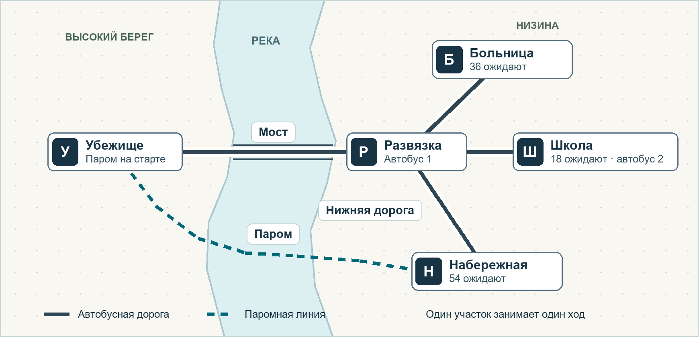

# Геймдизайн прототипа «Пока открыт мост»

Первый сценарий · версия 0.1 · ПК · одиночная пошаговая стратегия

Река выходит из берегов. Диспетчер управляет двумя автобусами и паромом. В трёх районах 108 жителей ждут эвакуации в убежище на высоком берегу. На третьем ходу можно открыть водосброс. Это сохранит мост ещё на три хода и на два хода раньше закроет паромную переправу.

[План реализации](implementation-plan.md)

## Содержание

- [О прототипе](#о-прототипе)
- [Карта и данные сценария](#карта-и-данные-сценария)
- [Правила хода и итог партии](#правила-хода-и-итог-партии)
- [Два плана эвакуации](#два-плана-эвакуации)
- [Экран и первая партия](#экран-и-первая-партия)
- [Сборка и проверка прототипа](#сборка-и-проверка-прототипа)

## О прототипе

### Задача игрока

Вывезти как можно больше людей до потери доступа к убежищу. Человек засчитывается в момент прибытия в убежище. Итог показывает общее число и результат по каждому району. Укрытие вмещает всех 108 жителей. Районы учитываются одинаково, поэтому при равном числе спасённых игрок сам определяет, какую группу считает приоритетной.

Партия рассчитана на 10–15 минут и длится до восьмого хода. Время идёт по кнопке «Выполнить ход». До подтверждения приказы можно менять свободно. После подтверждения карта и счётчики показывают результат хода.

### Цели игрового опыта

| Что должен почувствовать игрок | Как это создаётся | Что наблюдать в первой партии |
| --- | --- | --- |
| Давление растёт по мере подъёма воды | У закрывающихся участков указаны последние доступные ходы. Два автобуса делят один мост. | Игрок отправляет транспорт заранее, потому что видит приближение закрытия. |
| Решение меняет судьбу конкретных людей | Водосброс меняет сроки двух переправ. У каждого района свой счётчик. | Игрок объясняет, кто выиграет от открытия водосброса и кто потеряет маршрут. |
| Ошибку можно исправить в новой попытке | Расписание повторяется. Журнал связывает рейс с событием на карте. | Игрок называет ход, который хочет переиграть, и пробует другой маршрут. |

### Состав прототипа

Одна сценарная карта, пять узлов, пять двусторонних участков, три машины и одно решение о водосбросе. Подъём воды задаётся расписанием закрытия участков. Игровой экран объединяет карту, приказы, прогноз и журнал. Итоговый экран показывает число вывезенных и кнопку повтора.

## Карта и данные сценария

Убежище находится на высоком берегу. На стороне низины автобусы свозят людей через развязку к мосту. Паром идёт напрямую от набережной к убежищу. Любой участок проходится за один ход.

### Узлы и начальное состояние

| Узел | Ждут эвакуации | Транспорт на старте |
| --- | ---: | --- |
| У · Убежище | 0 | Паром П |
| Р · Развязка | 0 | Автобус А1 |
| Б · Больница | 36 | — |
| Ш · Школа | 18 | Автобус А2 |
| Н · Набережная | 54 | — |

### Участки и сроки закрытия

| Участок | Кто проходит | Последний ход при закрытом водосбросе | Последний ход при открытом водосбросе |
| --- | --- | --- | --- |
| Р ↔ У · мост | Автобусы | 4 | 7 |
| Н ↔ У · переправа | Паром | 6 | 4 |
| Р ↔ Н · нижняя дорога | Автобусы | 3 | 3 |
| Р ↔ Б · дорога к больнице | Автобусы | До конца | До конца |
| Р ↔ Ш · дорога к школе | Автобусы | До конца | До конца |

Последний ход включён в окно проезда. Например, без водосброса мост открыт весь ход 4 и закрывается перед выдачей приказов на ход 5.

Транспорт стартует пустым. У автобусов А1 и А2 и парома П по 18 мест. Мост допускает один автобус за ход в любом направлении. Остальные участки допускают одновременное движение всего подходящего транспорта.

## Правила хода и итог партии

В начале хода игрок видит позиции транспорта, ожидающих жителей и действующий прогноз. Пока открыт экран планирования, состояние карты и пассажиров фиксировано.

### Последовательность хода

1. **Применить закрытия.** Перед выдачей приказов закрываются участки, у которых истёк последний доступный ход. Все закрытия действуют до конца партии. Если оба входа в убежище закрыты, игра сразу показывает итог.
2. **Выбрать приказы.** Каждой машине назначается один соседний узел или «Ждать». Ожидание выбрано по умолчанию. На ходу 3 игрок также выбирает «Открыть водосброс» или «Оставить закрытым». Выбор вступает в силу при выполнении хода 3 и задаёт расписание до конца партии.
3. **Проверить план.** Перепроверить соседство, тип транспорта, доступность участков и лимит моста. Если два автобуса назначены на мост, выделить оба приказа и заблокировать подтверждение, пока один из них не изменится. Приказы можно править в любом порядке.
4. **Посадить пассажиров.** Перед выездом пустая машина автоматически забирает до 18 ожидающих из узла отправления. При общей очереди приоритет А1, затем А2, затем П. Машина с пассажирами сохраняет их до убежища. Ожидание оставляет машину и очередь на месте.
5. **Переместить транспорт.** Все приказы на движение выполняются одновременно. Каждая машина достигает выбранного узла к концу хода. Прибытие в промежуточный узел завершает ход машины. При прибытии в У все пассажиры выгружаются и засчитываются по району, из которого их забрали.
6. **Записать результат.** Обновить позиции, очереди и число вывезенных. Добавить в журнал посадки, прибытия и выбор водосброса. Перейти к следующему ходу с его закрытиями или к итогам.

### Окончание и подсчёт

Партия заканчивается, если спасены все, закрыты обе переправы в У или выполнен ход 8. Итог отдельно показывает вывезенных, ожидающих и людей в транспорте вне убежища. Для каждого района сумма этих трёх значений равна числу жителей на старте.

Схема детерминирована. Вода закрывает участки между ходами. Узлы, очереди и припаркованные машины сохраняют своё состояние, а люди в отрезанных районах продолжают числиться ожидающими. Пассажиры остаются в своей машине до прибытия в У.

## Два плана эвакуации

Оба плана начинают одинаково. К концу хода 3 в убежище 54 человека. Первый автобус и второй автобус стоят у убежища, паром уже вернулся к набережной. Стрелки показывают приказы на движение. Для остальных машин действует «Ждать».

### Общие приказы на первых трёх ходах

| Ход | Общие приказы | Кто прибыл в убежище | Всего |
| --- | --- | --- | --- |
| 1 | А1 Р → Б · А2 Ш → Р · П У → Н | Посадка в школе, высадок пока нет | 0 |
| 2 | А1 Б → Р · А2 Р → У · П Н → У | Школа 18 · набережная 18 | 36 |
| 3 | А1 Р → У · П У → Н | Больница 18 | 54 |

### Приказы после выбора водосброса

| Ход | План А · оставить водосброс закрытым | План Б · открыть водосброс |
| --- | --- | --- |
| 4 | П Н → У. Ещё 18 с набережной. Всего 72. | А1 У → Р · П Н → У. Ещё 18 с набережной. Всего 72. |
| 5 | Мост закрывается. П У → Н. | Переправа закрывается. А1 Р → Б. |
| 6 | П Н → У. Последние 18 с набережной. Всего 90. | А1 Б → Р. Забирает оставшихся 18 из больницы. |
| 7 | Переправа закрывается. Итог 90. | А1 Р → У. Последние 18 из больницы. Всего 90. |
| 8 | Партия завершена на предыдущем ходу. | Мост закрывается. Итог 90. |

### Результаты по районам

| Район | Всего | План А · вывезено | План Б · вывезено |
| --- | --- | --- | --- |
| Больница | 36 | 18 | 36 |
| Школа | 18 | 18 | 18 |
| Набережная | 54 | 54 | 36 |
| Итого | 108 | 90 | 90 |

План А сохраняет третий рейс парома. Для повторного автобусного рейса нужны четыре хода подряд, с 4-го по 7-й, поэтому он возможен в плане Б.

### Дополнительный маршрут для повтора

Если А1 начнёт Р → Н → Р → У и водосброс откроется на ходу 3, автобус заберёт 18 человек с набережной ещё до закрытия нижней дороги. Второй рейс А1 в больницу на ходах 4–7 вернёт итог 90 с распределением плана А. Полный перебор допустимых приказов дал максимум 90 человек при каждом положении водосброса.

## Экран и первая партия

Карта занимает основную часть экрана. Выбор машины открывает доступные соседние узлы. Щелчок по узлу назначает приказ и рисует стрелку до подтверждения. В панели машины указаны её позиция, загрузка и назначение. Кнопка «Ждать» снимает приказ.

| Область | Что показывает | Действие игрока |
| --- | --- | --- |
| Верхняя строка | Текущий ход, число вывезенных из 108 и ближайшее закрытие. | Сверяет цель текущего хода с прогнозом. |
| Карта | Сколько людей ждут в районе, где стоят машины и каким ходом заканчивается проезд. | Выбирает машину и один соседний узел. |
| Панель приказов | Позиция, пассажиры из 18, будущий узел и конфликты. | Меняет приказы, ждёт или выполняет ход. |
| Прогноз | Две шкалы до конца партии с последним ходом для моста и парома. | С первого хода сравнивает шкалы. На третьем выбирает режим. |
| Журнал и итог | Какие рейсы завершены, какие участки закрылись и сколько людей осталось по районам. | Проверяет последствия и начинает сценарий заново. |

### Как знакомить с правилами

- **Ход 1.** Короткая подсказка предлагает выбрать любую машину и показывает, что посадка происходит перед выездом. Игрок может выбрать первый рейс самостоятельно.
- **Ход 2.** При наведении на мост показать «Один автобус за ход». При конфликте рядом с обоими приказами появляется «Мост занят двумя автобусами. Измените один приказ».
- **Ход 3.** Показать обе шкалы рядом. Под текстом «Открыть водосброс» вывести «Мост до хода 7 · паром до хода 4». Под текстом «Оставить закрытым» вывести «Мост до хода 4 · паром до хода 6». Кнопка выполнения ждёт явного выбора.
- **При закрытии.** Линия становится прерывистой с поперечными засечками и подписью «Закрыт». Ближайший к закрытию участок получает значок и номер последнего хода. Формы, подписи и контраст сохраняют различия при отключённом цвете.

### Результат и повтор

Итог показывает число вывезенных, например «90 из 108», и разбивку по районам. Если закрытие отрезало район от убежища, показать соответствующее событие из журнала, например «Мост закрыт перед ходом 5». Кнопка «Повторить» восстанавливает стартовую карту и очищает приказы, прогноз выбранного режима и журнал.

## Сборка и проверка прототипа

### Порядок сборки

1. **Сценарий.** Задать узлы и их стартовые очереди, участки с типом транспорта, лимитом и последними ходами, а также машины с вместимостью и стартовыми позициями.
2. **Правила.** Хранить номер хода, режим водосброса, позиции, пассажиров с районом отправления, очереди и счётчики. Расчёт хода принимает текущий снимок и приказы, затем выдаёт следующий снимок и список событий. Прогноз и проверка приказов используют то же расписание.
3. **Экран.** Подключить карту, выбор соседнего узла, предупреждения о конфликте и смену хода. Затем добавить сравнение прогнозов, итог по районам и повтор.

### Проверки перед плейтестом

| Ситуация | Ожидаемое поведение |
| --- | --- |
| [Оба плана эвакуации](#два-плана-эвакуации) | Сохранить итог 90 в каждом плане и получить указанные результаты по районам. |
| Мост на предельном ходу | При закрытом водосбросе ход 4 принимает приказ, ход 5 отклоняет. При открытом граница проходит между 7 и 8. |
| Два встречных автобуса | Оба приказа выделены. Подтверждение доступно после исправления одного приказа. |
| Ожидание и посадка | Ожидание у школы оставляет очередь 18. После выезда пассажиры находятся в автобусе. Счёт растёт только при прибытии в У. |
| Открытие водосброса и повтор | На ходу 3 прогноз меняет оба срока. Повтор восстанавливает три стартовые очереди и позиции машин. |

### Плейтест на десяти игроках

Дать игроку задачу «Вывези как можно больше людей» и наблюдать без подсказок. Записать первый ход, прогноз игрока перед выбором водосброса, итог по районам и добровольный повтор. Сразу после подтверждения хода 3 попросить игрока своими словами назвать последствия выбора. После партии спросить, какой приказ он изменил бы.

Рабочие ориентиры для итерации — не менее 7 из 10 верно объясняют оба изменения сроков и не менее 6 из 10 сами начинают повтор. Если теряются в сроках, исправить обозначения и прогноз. Если сроки понятны, а повторять не хочется, проверить, есть ли смысл менять первые рейсы и ощущается ли потеря второго маршрута.

### Источники геймдизайна

- Предсказуемая угроза перед выбором хода. [Into the Breach Design Postmortem](https://media.gdcvault.com/gdc2019/presentations/Into%20the%20Breach%20Postmortem%20Final.pdf)
- Читаемая транспортная карта. [Dinosaur Polo Club · Mini Metro](https://dinopoloclub.com/press/mini-metro/)
- Проверка опыта игрока через прототип и наблюдение. [Трейси Фуллертон · Game Design Workshop](https://www.routledge.com/game-design-workshop-a-playcentric-approach-to-creating-innovative-games/fullerton/p/book/9781032607009)
- Дублирование цветовых сигналов формой и текстом. [Xbox Accessibility Guideline 103](https://learn.microsoft.com/en-us/gaming/accessibility/xbox-accessibility-guidelines/103)
